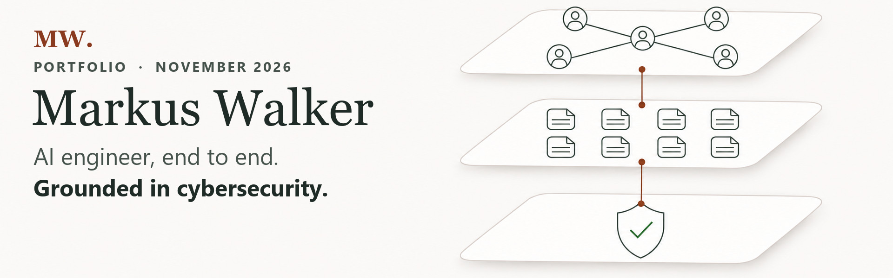

  

  
  

  
  
  

  
  
  
  

I'm an AI engineer in Brisbane. I take agentic AI from the first scoping conversation through architecture, build, security controls and handover, with thirteen years of cybersecurity, IT infrastructure and operational technology behind it. Most of my current work is Checkable AI and the ontology and knowledge graph underneath it. The quickest way to judge it is to use it.

> [!TIP]
> **Start with Checkable AI.** Its checks, knowledge base and graph explorer are live and open to try. My résumé, CV, white papers and write-ups are on my portfolio site.

## Start here

| 1. See it built | 2. See who built it |
|---|---|
| **[Checkable AI](https://www.checkableai.com/)** Free AI checks, a knowledge base of what AI vendors document, a graph explorer and a working CI demo. Real, running and open to try.  **[Source on GitHub](https://github.com/checkable-ai)** | **[markuswalker.com](https://www.markuswalker.com/)** Résumé and CV, project write-ups, experience and how I work.  **[Résumé (PDF)](https://www.markuswalker.com/Markus_Walker_Resume.pdf)** |

## The ontology and the knowledge graph

Checkable AI runs on a knowledge base that agents research, verify and keep current, and that knowledge base runs on an ontology I designed: a shared vocabulary of AI platforms, security controls, findings, sources and frameworks, so every answer traces back to the page and line it came from. The graphs are built on open W3C standards (RDF 1.1, SPARQL 1.1, SHACL, PROV-O and SKOS), so any standard tool can load, query and re-check them.

- **[Graph explorer](https://www.checkableai.com/stack-check/graph/)**: the knowledge graph behind the AI Stack Check, live. Turn the dial to a platform to see the controls it documents, then pick a control to open the finding, its receipt and the path it takes through the graph.
- **[Knowledge base](https://www.checkableai.com/stack-check/atlas/)**: every tracked AI platform with its findings and sources, one plain page per answer.
- **[How the graph is checked](https://www.markuswalker.com/projects/checked-knowledge-graph/)**: Markdown knowledge bases become RDF graphs with a provenance receipt on every link and a SHACL rulebook on every build, checked across 3.1 million triples on one host. October 2026.
- **[The Offerings Atlas](https://www.markuswalker.com/projects/offerings-atlas/)**: the knowledge base behind it, with checkable provenance on every finding.

Beyond the public site, I build, host and maintain these graphs on my own bare-metal server in private practice: a W3C-standard RDF store that I curate and keep current, and that my agents query day to day.

## Selected writing

| Title | What it is |
|---|---|
| [Securing Claude Cowork: controls, gaps and safer defaults](https://www.markuswalker.com/projects/claude-cowork-controls-cheat-sheet/) | What the Claude Cowork admin console, device policy and third-party deployments control, and which defaults to change first. Version 1.4, September 2026. |
| [Human, script or AI? Spotting AI-driven attacks in the SOC](https://www.markuswalker.com/projects/distinguishing-ai-driven-attacks/) | A SOC advisory white paper on telling AI-driven attacks apart from human and automated activity, with guidance for detection, triage and response. Version 5, September 2026. |
| [Turning a knowledge base into a graph you can check](https://www.markuswalker.com/projects/checked-knowledge-graph/) | The engineering write-up behind the graph above: content-hash IDs, one provenance assertion per link, 119 SHACL rules, and a chunked check that scales to millions of triples. October 2026. |

**[All write-ups and white papers](https://www.markuswalker.com/projects/)**, plus [security write-ups and lab walkthroughs](https://markus-doc.github.io/cybersecurity-writeups/) from earlier in the year.

## Checkable AI: publications and open samples

- **[Reports](https://www.checkableai.com/reports/)**: dated reports from the register of AI platforms, each with its count, method and sources. The first: [only 7 of 230 AI services document security telemetry a security team can use](https://www.checkableai.com/reports/soc-telemetry-2026/).
- **[Guides](https://www.checkableai.com/guides/)**: plain-words articles on AI security and Australian rules, such as [the Privacy Act and AI tools](https://www.checkableai.com/guides/privacy-act-and-ai-tools/) and [AI and the Essential Eight](https://www.checkableai.com/guides/ai-and-the-essential-eight/).
- **Live checks**: the [AI Stack Check](https://www.checkableai.com/stack-check/) and the [AU Frameworks Check](https://www.checkableai.com/readiness-check/) run on the same knowledge base.
- **[knowledge-base-preview](https://github.com/checkable-ai/knowledge-base-preview)**: what 116 AI platforms document, checked against the same 46 security controls, one plain page per answer.
- **[ci-demo](https://github.com/checkable-ai/ci-demo)**: catches AI vendor changes before your code ships, with nightly pull requests, a named sign-off gate, a deploy gate and a Kubernetes check.

## My public repositories

| Repository | What it is |
|---|---|
| [headless-llm-gateway](https://github.com/Markus-Doc/headless-llm-gateway) | One local OpenAI-compatible endpoint that routes agent calls to headless Claude Code and Codex, with a proof record per call. [Write-up](https://www.markuswalker.com/projects/llm-gateway/). |
| [governed-ai-agent](https://github.com/Markus-Doc/governed-ai-agent) | A governed AI agent on an open knowledge base, with policy as code and a security model that treats the agent as untrusted. [Write-up](https://www.markuswalker.com/projects/governed-ai-agent/). |
| [MCP_Governance_Platform](https://github.com/Markus-Doc/MCP_Governance_Platform) | A working proof of concept for governing AI agent and MCP-connected integrations: intake, risk classification, human review and an evidence trail. |
| [cybersecurity-writeups](https://github.com/Markus-Doc/cybersecurity-writeups) | Red Team Capstone crawl-through and other security write-ups. [Read it as a site](https://markus-doc.github.io/cybersecurity-writeups/). |
| [cybersecurity-portfolio](https://github.com/Markus-Doc/cybersecurity-portfolio) | Capability design kept apart from technical write-ups, with downloadable deliverables. [Read it as a site](https://markus-doc.github.io/cybersecurity-portfolio/). |
| [claude-study-game](https://github.com/Markus-Doc/claude-study-game) | Runner, a pixel-art study game for the Claude Certified Architect, Foundations exam, built with Phaser and TypeScript. [Play it](https://www.markuswalker.com/runner/). |

**93 repositories in total, 13 of them public** (as of November 2026). The other 80 are private lab, business and study work, which is what sits behind the contribution graph further down this page.

<strong>What I work on</strong>: secure AI delivery, agent architecture, MCP governance and knowledge graphs

- **Secure AI delivery.** Sovereign AI environments on Azure, with Azure AI Foundry models hosted in an Australian region, and the access and device controls that hold each machine to an approved configuration.
- **Agentic architecture.** Reference architectures that stay independent of any one cloud or model, so the security posture survives a change of platform underneath.
- **MCP and agent governance.** Governing agent and MCP-connected integrations before they become unmanaged risk.
- **Knowledge graphs agents can reason over.** Ontologies, RDF graphs with provenance on every link, and the ingestion, redaction, retrieval and checking tooling around them.

Thirteen years in cybersecurity, IT infrastructure and operational technology sit behind that, including seven running IT and OT for upstream and midstream gas operations across more than twenty remote sites.

<strong>How I build</strong>: two convictions that shape most of the work

**Build what frontier AI will not replace.** Models keep getting better, so anything a future model will do natively is throwaway work. The durable investment is what stays personal and owned, starting with an organisation's own knowledge base. That is why the work leans towards harnesses and governance around a model rather than wrappers over one.

**Keep the engine swappable.** Nobody knows which tools last. Claude, Codex, ChatGPT, Kimi, Grok, Cursor or something still to come could win, so the engine has to be a replaceable part: open formats, standard protocols such as MCP and RDF, and instructions any agent can read.

<strong>Credentials</strong>: AWS, Oracle Cloud, Anthropic and Certificate IV in Cyber Security

AWS Certified Solutions Architect, Associate. Three Oracle Cloud Infrastructure certifications, including Generative AI Professional. Anthropic Claude Certified Associate, Foundations. Certificate IV in Cyber Security. Australian citizen, eligible for NV1 and NV2.

  <a href="https://www.checkableai.com/"><strong>Checkable AI</strong></a>
  &nbsp;&middot;&nbsp;
  <a href="https://github.com/checkable-ai"><strong>Checkable AI on GitHub</strong></a>
  &nbsp;&middot;&nbsp;
  <a href="https://www.markuswalker.com/"><strong>markuswalker.com</strong></a>
  &nbsp;&middot;&nbsp;
  <a href="https://www.linkedin.com/in/markus-walker-au/"><strong>LinkedIn</strong></a>

  MIT licence, copyright (c) 2026 M. Walker. See <a href="LICENSE">LICENSE</a>.

